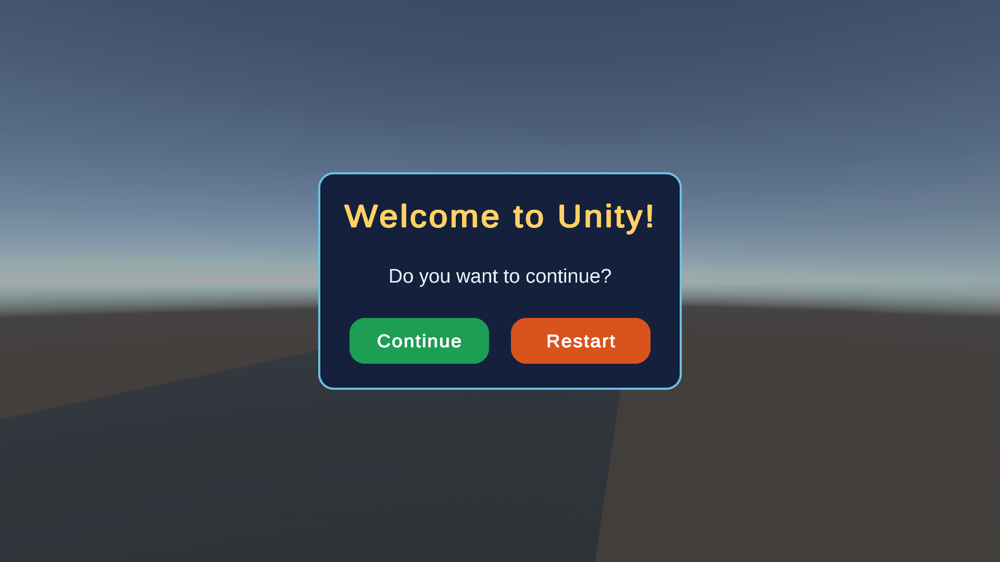

# Unity Lab 5 – UI Design Elements (Pop-up menu)

Bài thực hành **"Practice: UI Design Elements"** cuối slide 3.3 *User Interface Design – Buttons, Text, and Images*.

- Unity **6000.3.23f1** (Unity 6.3 LTS), template **Universal 3D (URP 17.3)**
- Input: **Input System mới** (Active Input Handling = Input System Package)
- UI: uGUI + **TextMeshPro** (TMP Essentials đã import)



## Nội dung bài làm

1. Pop-up menu gồm tiêu đề, thông điệp và 2 nút **Continue** / **Restart** (Canvas, Panel, TextMeshPro, Button - TextMeshPro).
2. Popup **chỉ hiện** khi máy bay **đã cất cánh** và va chạm với `Wall` (Enter Wall). Title, Message, chữ trên nút được nạp từ code.
3. Nút Continue chuyển sang scene kế tiếp, nút Restart nạp lại scene hiện tại.

> **Lưu ý:** project này không có sẵn cảnh của bài trước (máy bay cất cánh, Wall, `EnterGame.cs`).
> Phần **máy bay, đường băng, animation cánh, Wall là bản tối giản tự dựng** (primitive Unity, không tải asset ngoài) để thay thế bài trước và phục vụ việc kiểm thử popup.

## Cách chạy thử

1. Mở project bằng Unity 6000.3 (lần đầu Unity sẽ tự cài các package trong `Packages/manifest.json`).
2. Mở `Assets/Scenes/_Scene_3_2.unity`, bấm **Play**.
3. Ban đầu máy bay đứng yên và **không có popup**.
4. Nhấn **Space** để cất cánh: cánh xoay (animation `ThrottleUp`), máy bay bay tới và bay lên nhẹ.
5. Máy bay chạm `Wall` (khối xanh bán trong suốt) → popup hiện, cảnh dừng lại (`Time.timeScale = 0`).
6. **Continue** → nạp `_Scene_1` (có nút **Back** để quay lại `_Scene_3_2`). **Restart** → nạp lại `_Scene_3_2`.

Hai scene đều nằm trong **Build Profiles > Scene List** (`_Scene_3_2` index 0, `_Scene_1` index 1), nên `SceneManager.LoadScene` theo tên chạy được.

## Cấu trúc thư mục

```
Assets/
├─ Scenes/      _Scene_3_2.unity (chính), _Scene_1.unity (scene kế tiếp)
├─ Scripts/     AirplaneController.cs, GameManager.cs, EnterGame.cs, SceneLoader.cs
├─ Animations/  ThrottleUpAnimation.anim, AirplaneController.controller
├─ Materials/   Runway, AirplaneBody, AirplaneWing, AirplaneTail, WallTransparent
├─ UI/          RoundedRect.png, FramePanel.png (sprite bo góc, sinh bằng code)
└─ TextMesh Pro/ (TMP Essential Resources)
```

## Hierarchy của `_Scene_3_2`

```
Main Camera            (GameManager)
Directional Light
Runway                 (Plane, scale 3x1x20)
Airplane               (Tag = Player, Rigidbody, CapsuleCollider, AirplaneController)
├─ AirplaneBody        (Capsule nằm ngang)
├─ AirplaneWing        (Cube dẹt, Animator + AirplaneController.controller)
└─ AirplaneTail        (Cube nhỏ)
Wall                   (Cube, Box Collider Is Trigger, EnterGame, material trong suốt)
Canvas                 (Screen Space - Overlay, Scale With Screen Size 1920x1080, Match 0.5)
└─ Panel               (Image đen alpha 0.6, phủ toàn màn hình)
   └─ Frame            (Image 700x420, Horizontal Layout Group)
      ├─ Title         (TMP_Text)
      ├─ Message       (TMP_Text)
      ├─ Enter         (Button - TextMeshPro, nút Continue)
      └─ Restart       (Button - TextMeshPro)
EventSystem            (InputSystemUIInputModule)
```

## Các bước đã làm

### 1. Dựng UI (Canvas / Panel / TMP / Button)
- **Canvas**: Screen Space - Overlay; Canvas Scaler = Scale With Screen Size, 1920x1080, Match 0.5.
- **EventSystem** dùng **`InputSystemUIInputModule`** (không dùng `StandaloneInputModule`), vì project dùng Input System mới; nếu không nút sẽ không bấm được.
- **Panel**: Image đen alpha 0.6, anchor stretch toàn màn hình để làm mờ cảnh.
- **Frame**: hộp 700x420 ở giữa, sprite bo góc nền navy `#14213D` viền xanh sáng `#6EC1E4`. `Horizontal Layout Group` (padding 60, spacing 40, căn dưới) xếp hai nút bằng nhau cạnh nhau; `Title` và `Message` có `Layout Element > Ignore Layout` và neo lên phía trên.
- **Title**: 64 pt, đậm, vàng `#FFD166`. **Message**: 38 pt, `#E6EDF7`, căn giữa.
- **Nút**: cao 90, chữ 36 pt đậm trắng. Continue xanh lá `#1E9E55`, Restart cam đỏ `#D9531E`. Color Tint đã cấu hình cho Normal / Highlighted / Pressed / Disabled (và Selected).
- Layout dùng anchor + Layout Group nên popup giữ đúng vị trí ở 1920x1080 và 1280x720.

### 2. `GameManager.cs` (gắn lên Main Camera)
- Trường public: `GameMenu` (Canvas), `Title`, `Message`, `ContinueButton`, `RestartButton`.
- `Start()`: `GameMenu.enabled = isShowingMenu` (tắt popup mặc định) rồi nạp text từ code:
  `"Welcome to Unity!"`, `"Do you want to continue?"`, `"Continue"`, `"Restart"`.
- `ShowMenu()`: bật Canvas và đặt `Time.timeScale = 0`.
- `NextScene()` → `LoadScene("_Scene_1")`; `RestartScene()` → `LoadScene("_Scene_3_2")`. Cả hai đặt `Time.timeScale = 1f` trước khi load.

### 3. `EnterGame.cs` (gắn lên Wall)
- Trường public `GameMenu` (Canvas).
- `OnTriggerEnter(Collider other)`: chỉ hiện popup khi collider thuộc `AirplaneController` có Tag `Player` **và** `hasTakenOff == true`, và chỉ hiện **một lần** (cờ `hasShown`). Nếu chưa cất cánh thì bỏ qua.
- Dùng `GameManager.ShowMenu()` nếu có trong scene, ngược lại bật `GameMenu.enabled = true`.

### 4. Nối tham chiếu và onClick (như slide: kéo-thả trong Inspector)
- `Main Camera > GameManager`: Canvas → GameMenu, Title, Message, `Enter` → ContinueButton, `Restart` → RestartButton.
- `Wall > EnterGame`: Canvas → GameMenu.
- `Enter.onClick` → `Main Camera (GameManager).NextScene`; `Restart.onClick` → `Main Camera (GameManager).RestartScene` (persistent listener trong Editor, không dùng `AddListener`).

### 5. Phần máy bay tối giản (thay cho bài trước)
- `AirplaneController.cs`: `public bool hasTakenOff { get; private set; }`. Nhấn **Space** (`Keyboard.current.spaceKey`) → `SetTrigger("takeoff")` trên Animator của cánh, `hasTakenOff = true`, đặt `Rigidbody.linearVelocity` (tiến theo trục Z, bay lên nhẹ). Chưa nhấn Space thì máy bay đứng yên. Rigidbody: Use Gravity tắt, Is Kinematic tắt, Collision Detection = Continuous.
- Animation `ThrottleUpAnimation.anim`: cánh xoay Rotation.x `0 → -3.75 → -7.5 → -11.25 → -15` trong 1 giây, không lặp. `AirplaneController.controller`: state `Idle` (mặc định, rỗng) → `ThrottleUp`, trigger `takeoff`, Has Exit Time = false.

## Kết quả kiểm thử (Play Mode)

| Kiểm tra | Kết quả |
|---|---|
| Vào Play: Canvas tắt, máy bay đứng yên | Đạt |
| Title/Message/chữ nút nạp từ code | Đạt |
| Va chạm Wall khi **chưa** cất cánh | Popup **không** hiện |
| Cất cánh rồi chạm Wall | Popup hiện, `timeScale = 0` |
| Continue → `_Scene_1`; Back → `_Scene_3_2` | Đạt |
| Restart → nạp lại `_Scene_3_2`, popup tắt, `timeScale = 1` | Đạt |
| Console | Không có error / warning / exception |

## Ghi chú Git

- `.gitignore` chuẩn Unity, bỏ qua `Library/ Temp/ Obj/ Logs/ UserSettings/ *.csproj *.sln *.slnx`, `.mcp.json` (chứa access token), `.claude/settings.local.json`, `.claude/skills/`, `Assets/Plugins/NuGet/`. File `.meta` **không** bị bỏ qua.
- Cần commit: `Assets/`, `Packages/`, `ProjectSettings/`, `docs/`, `README.md`, `.gitignore`.
- Package `com.ivanmurzak.unity.mcp` (Unity-MCP) có trong `Packages/manifest.json` chỉ phục vụ việc thao tác Editor từ AI; có thể gỡ mà không ảnh hưởng bài làm.
